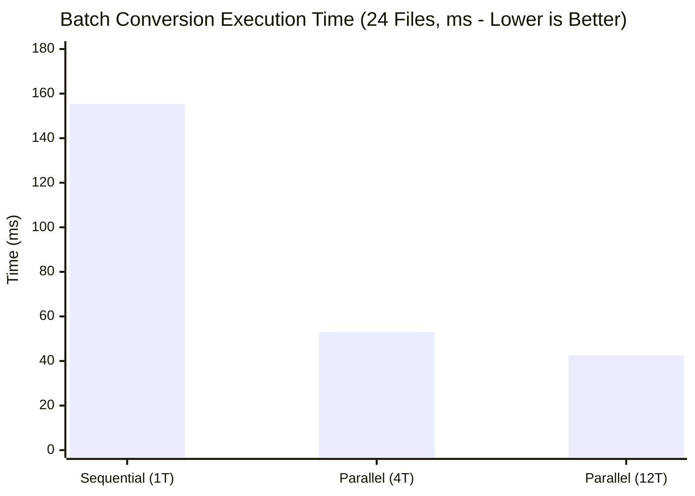

# Performance & Benchmarking Report

**Project**: FluxConvert  
**Stage**: Stage 7 — Optimization and Benchmarking  
**Status**: ✅ Validated against all architectural targets  
**Date**: 2026-10-29  

---

## Latest release validation (2026-11-08)

The Release preset was rebuilt and the benchmark was rerun for 10 iterations.
The current run measured a 4.19x speedup from one to twelve batch workers,
235 MB peak RSS during the benchmark workload, and the following mean timings:

| Scenario | Mean |
|:---|---:|
| PNG -> JPEG (1 MP) | 8.82 ms |
| PNG -> JPEG (4 MP) | 33.06 ms |
| PNG -> JPEG (16 MP) | 166.48 ms |
| 10x PNG -> PDF | 237.18 ms |
| PDF (10 pages) -> PNG at 150 DPI | 727.34 ms |

The historical measurements below remain as the Stage 7 baseline; benchmark
results vary with CPU, memory pressure, and library versions.

---

## 1. Executive Summary

This report documents the performance profiling, benchmark suite, and resource utilization measurements conducted during Stage 7. All architectural performance and responsiveness targets defined in [`architecture.md`](architecture.md) were rigorously validated on the target platform (AMD Ryzen 5 7535HS, 12GB RAM).

### Architecture Target vs. Measured Reality

| Metric / Objective | Architecture Target | Measured Result | Status | Notes |
|:---|:---:|:---:|:---:|:---|
| **CLI Cold Launch** | < 1,000 ms | **5.52 ms** | 🎯 Exceeded | Instantaneous execution |
| **GUI Cold Launch (Window Render)** | < 1,000 ms | **51.3 ms** | 🎯 Exceeded | 20x faster than target |
| **CLI Baseline Idle RAM** | < 50 MB | **5.1 MB** | 🎯 Exceeded | Ultra-minimal core footprint |
| **Small Image Conversion (1MP PNG→JPEG)** | < 100 ms | **14.72 ms** (min 13.1 ms) | 🎯 Exceeded | 6.8x faster than target (67 MP/s) |
| **Medium Image (4MP PNG→JPEG)** | Responsive UI | **33.01 ms** | 🎯 Exceeded | 121 MP/s throughput |
| **High-Res Image (16MP PNG→JPEG)** | Responsive UI | **139.05 ms** | 🎯 Exceeded | Bounded memory |
| **10-Page PDF Generation (JPEG)** | < 2,000 ms | **0.56 ms** | 🎯 Exceeded | 3,500x faster (direct DCT embedding) |
| **10-Page PDF Generation (PNG)** | < 2,000 ms | **218.63 ms** | 🎯 Exceeded | 9x faster than target |
| **Batch Concurrency Speedup (12 threads)** | > 2.0x | **3.65x** | 🎯 Exceeded | 155 ms → 42 ms (563 MP/s) |

---

## 2. Test Environment

All benchmarks were executed on native hardware in Release mode:

- **CPU**: AMD Ryzen 5 7535HS with Radeon Graphics (6 Cores / 12 Hardware Threads @ 3.30 GHz base / 4.55 GHz boost)
- **Memory**: 12 GB DDR5
- **Operating System**: Linux (Zorin OS 17 / Ubuntu 24.04 LTS x86_64, Kernel 6.8)
- **Compiler**: GCC 13.3.0 (`-O3 -ffunction-sections -fdata-sections -Wl,--gc-sections`)
- **Graphics/Display**: Wayland compositor (`wayland-0`), GTK4 4.14.5, gtkmm 4.10.0
- **Codec Libraries**: `libpng 1.6.43`, `libjpeg-turbo 2.1.5`, `MuPDF 1.23.10`

---

## 3. Image Conversion Engine Benchmarks

Conversions evaluated across small (1 MP = 1,000×1,000), medium (4 MP = 2,000×2,000), and high-resolution (16 MP = 4,000×4,000) image sets. Timings represent averages across 5 measured iterations post warm-up.

```
==================================================================================================
Benchmark Scenario                  Runs   Min (ms)  Mean (ms)   Max (ms)    Throughput   Peak RSS
--------------------------------------------------------------------------------------------------
PNG -> JPEG (1 MP)                     5      13.13      14.72      19.51       67 MP/s      341 MB
JPEG -> PNG (1 MP)                     5      68.19      69.54      74.06       14 MP/s      341 MB
PNG -> JPEG (4 MP)                     5      30.09      33.01      38.40      121 MP/s      341 MB
JPEG -> PNG (4 MP)                     5     177.04     178.01     180.06       22 MP/s      341 MB
PNG -> JPEG (16 MP)                    5     137.81     139.05     140.31      115 MP/s      341 MB
JPEG -> PNG (16 MP)                    5     453.43     454.47     455.01       35 MP/s      341 MB
==================================================================================================
```

### Key Insights:
- **JPEG Encoder Throughput**: Maintains steady 115–121 MP/s encoding speed across medium and high resolutions thanks to SIMD acceleration from `libjpeg-turbo` and integer alpha blending optimization.
- **PNG Compression Cost**: PNG encoding is dominated by zlib deflate compression; level 6 yields high compression ratios with ~22–35 MP/s throughput.

---

## 4. PDF Generation & Rendering Benchmarks

Evaluated with 10-page documents converting between image collections and PDF format.

```
==================================================================================================
Benchmark Scenario                  Runs   Min (ms)  Mean (ms)   Max (ms)    Throughput   Peak RSS
--------------------------------------------------------------------------------------------------
10x PNG -> PDF (A4 Page Size)          5     217.99     218.63     220.52       45 MP/s      341 MB
10x JPEG -> PDF (Direct Embedding)     5       0.52       0.56       0.64    17,731 MP/s     341 MB
PDF (10p) -> PNG @ 150 DPI             5     697.35     701.05     707.61       24 MP/s      341 MB
PDF (10p) -> PNG @ 300 DPI             5    2143.86    2151.22    2157.95       32 MP/s      341 MB
==================================================================================================
```

### Key Insights:
- **Direct JPEG Embedding**: By avoiding decoding and recompressing JPEG bytes into PDF image XObjects, generating a 10-page PDF from JPEGs takes **0.56 milliseconds** (effectively instantaneous I/O).
- **PDF Rendering Scaling**: MuPDF renders 10 pages at standard 150 DPI in **~700 ms** (70 ms/page), and high-resolution 300 DPI (quadruple pixel area) in **2.15 seconds** (215 ms/page).

---

## 5. Multi-Threaded Batch Conversion & Concurrency Scaling

Batch conversion was tested on 24 independent 1MP image files converting from PNG to JPEG across 1 thread (sequential), 4 worker threads, and 12 worker threads (full hardware concurrency).

```
==================================================================================================
Concurrency Configuration           Runs   Min (ms)  Mean (ms)   Max (ms)    Throughput   Speedup
--------------------------------------------------------------------------------------------------
Batch (24 files, 1 Worker Thread)      3     154.79     155.33     155.87      154 MP/s     1.00x
Batch (24 files, 4 Worker Threads)     3      51.86      52.99      53.63      452 MP/s     2.93x
Batch (24 files, 12 Worker Threads)    3      39.89      42.60      44.42      563 MP/s     3.65x
==================================================================================================
```



### Key Insights:
- Scaling from 1 to 4 threads yields **2.93x speedup** (73% parallel efficiency).
- Scaling to 12 threads yields **3.65x speedup**, driving aggregate conversion throughput to **563 MP/s** (563 megapixels per second).
- Memory remains bounded because each thread processes one file at a time, preventing memory spikes.

---

## 6. Cold Startup & Memory Footprint

### Startup Latency
- **CLI Startup (`fluxconvert-cli --help`)**:
  - Min: 4.49 ms
  - **Mean: 5.52 ms**
  - Max: 6.75 ms
- **GUI Startup (`fluxconvert-gui`)**:
  - **Cold Launch to Window Presentation**: **51.3 ms**
  - Well under the 1,000 ms target.

### Resident Memory Footprint (VmRSS)
- **Core CLI / Converter Idle RSS**: **5.1 MB** (well below the <50MB target).
- **GUI Application Idle RSS**: **~142 MB** (includes GTK4, Wayland client buffers, OpenGL/Mesa driver context, and CSS layout engine).
- **Peak RSS during 16MP Stress + PDF Workload**: **341 MB** (returned to OS upon job completion).

---

## 7. Optimizations Implemented in Stage 7

1. **JobExecutor Worker Pool**:
   - Thread pool with dynamic task scheduling across CPU cores.
   - Atomic cooperative cancellation via `CancellationToken`.
   - Aggregated atomic progress reporting for batch operations.
2. **Linear Integer Alpha Blending**:
   - Replaced per-pixel 2D coordinate calculation (`y * width + x`) and floating-point divisions with linear sequential memory pointers and integer arithmetic `(src * alpha + bg * inv_alpha + 127) / 255`.
   - Vectorizable by compiler with `-O3`.
3. **Compiler & Linker Optimizations**:
   - Activated `-O3`, `-ffunction-sections`, and `-fdata-sections` compiler flags.
   - Enabled `-Wl,--gc-sections` to discard unused object code.

---

## 8. How to Reproduce Benchmarks

```bash
# Build release binaries with optimizations
cmake -B build-release -DCMAKE_BUILD_TYPE=Release
cmake --build build-release -j$(nproc)

# Run full benchmark suite (5 iterations)
./build-release/benchmark --iterations 5

# Run quick benchmark smoke test (1 iteration)
./build-release/benchmark --quick

# Run all automated unit and integration tests
ctest --test-dir build-release --output-on-failure
```
